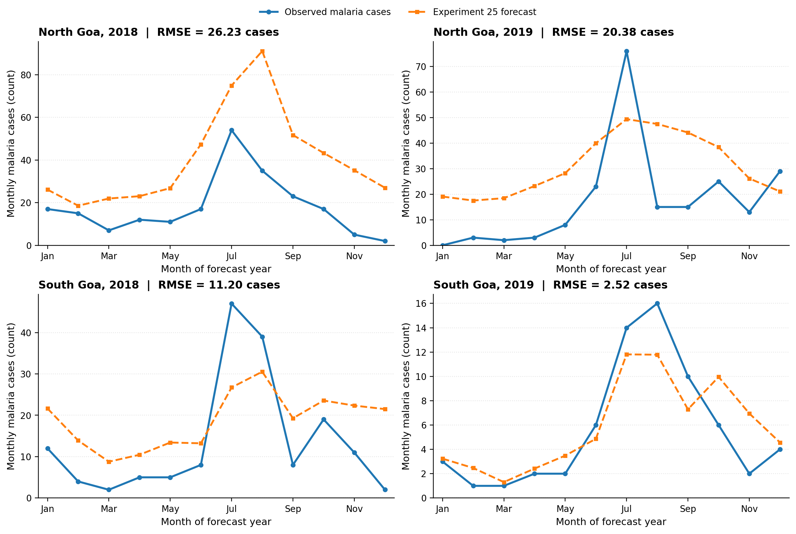
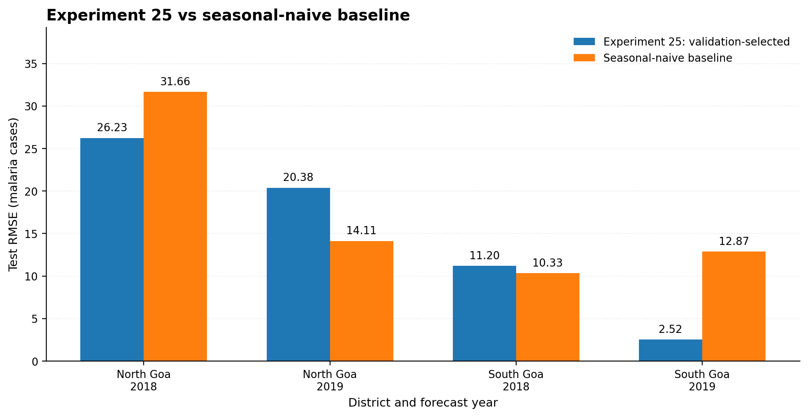

# Reproducing Hussain et al. (2025): Malaria Forecasting in Goa

A replication of the forecasting methodology in:

> Hussain et al. (2025). *Climate-based malaria forecasting in Goa using time-series, machine-learning and hybrid ML–ARMA models.* PLOS Global Public Health 5(10): e0004500. https://doi.org/10.1371/journal.pgph.0004500
<!-- Check the title above against the paper and edit if needed. -->

This repository is part of an undergraduate thesis. The replication provides the forecasts that later stages of the thesis verify, and it treats the original paper as a **specification** that the implementation must satisfy. The motivation to replicate this work is more on the side of an exploratory phase in my research, I simply wanted to understand how forecasting models actually work, beyond simply reading about them - I felt it would be a good way to learn hands-on, understand the challenges involved, and become more familiar with the methods. And since my proposed research involved verifying forecasts(to understand exactly which factor explains the malaria cases- using the concept of Explainability, using SHAP(feature importance method)). I thought this would also give me a practical starting point to build upon.

---

## What was replicated

| Component | Original paper | This replication |
|---|---|---|
| Setting | North and South Goa, monthly malaria cases, 2010–2019 | Same |
| Climate predictors | 6 variables selected from 15 (mostly extremes), ERA5 | Same 6: max temperature, min temperature, total rainfall, average relative humidity, max pressure, min wind speed |
| Train/test design | Test on 2018 and on 2019, per district | Same: 2010–2017 → 2018 and 2010–2018 → 2019 (4 experiments) |
| Models | SVM, RF, XGBoost; ARIMA, SARIMA, SARIMAX; hybrid ML–ARMA | Seasonal naive, SARIMA, SARIMAX, SVR, XGBoost, Ridge; hybrid XGB-ARMA |
| SARIMA order | (1,1,1)(0,1,1,12) | Used as the base order |
| Hybrid features | SARIMA components plus climate | Previous-month value, SARIMA residuals at lags 1 and 12, plus the 6 climate predictors |
| Metrics | RMSE, MAE | RMSE, MAE, MASE (scaled by seasonal naive) |

## Rules made explicit

Where the paper left choices open, this replication fixes them as rules:

1. **Strictly recursive forecasting.** Each 12-month test year is forecast using the model's own earlier predictions. No observed validation or test case value ever enters the recursion.
2. **Leakage-free hybrid features.** During the test year, lags and residuals are built from predictions only.
3. **Selection on validation only.** Models and hyperparameters are chosen with rolling-origin (expanding-window) validation inside the training years. The test year is not used for selection.

Together these form a **no-leakage invariant**: no observed future value is used to produce any forecast.

---

## Results (test RMSE)

| | North Goa 2018 | North Goa 2019 | South Goa 2018 | South Goa 2019 |
|---|---:|---:|---:|---:|
| Paper: best hybrid | 0.72 (SVM-ARMA) | 1.07 (SVM-ARMA) | 8.74 (XGB-ARMA) | 3.02 (XGB-ARMA) |
| Paper: SARIMA | 14.99 | 16.99 | 9.88 | 8.38 |
| **This replication: chosen on validation** (Experiment 25) | **26.23** | **20.38** | **11.20** | **2.52** |
| Seasonal naive | 31.66 | 14.11 | 10.33 | 12.87 |
| This replication: lowest test RMSE observed\* | 11.84 | 13.47 | 7.85 | 2.37 |

Models chosen on validation (Experiment 25): log-Ridge (NG 2018), log-SVR (NG 2019), SARIMA (SG 2018), SARIMA (SG 2019).

\* *Best observed across all experiments after inspecting test results. These are exploratory benchmarks, not unbiased estimates, because they could not have been chosen in advance.*

**Key finding:** under the rules above, the very low hybrid errors reported in the paper could not be reproduced. Results under honest model selection are of the same order as SARIMA and seasonal-naive baselines.

---

## Repository layout

The scripts locate data and results relative to the repository root (two levels above each script). Expected layout:

```
Reproduced_PLOS_Paper_Methodology/
├── README.md
├── corrected_a_branch_results.md
├── data/
│   └── processed/
│       └── district_splits/
│           ├── north_goa_2018_train.csv
│           ├── north_goa_2018_test.csv
│           ├── north_goa_2019_train.csv
│           ├── north_goa_2019_test.csv
│           ├── south_goa_2018_train.csv
│           ├── south_goa_2018_test.csv
│           ├── south_goa_2019_train.csv
│           └── south_goa_2019_test.csv
├── src/
│   └── experiments/
│       ├── experiment_14_district_xgb_arma_rebuilt.py
│       ├── experiment_17_district_hybrids.py
│       ├── experiment_18_model_selection.py
│       ├── experiment_21_north_2019_log_sarima.py
│       ├── experiment_22_branch_a_benchmark.py
│       ├── experiment_23_direct_forecasting.py
│       ├── experiment_25_independent_selection.py
│       ├── experiment_26_targeted_optimisation.py
│       ├── experiment_27_north_goa_decomposition.py
│       ├── experiment_28_peak_sensitive_direct.py
│       └── experiment_29_consolidation.py
└── results/
    └── summary/
        ├── corrected_branch_a_results.md
        ├── all_recomputed_test_metrics.csv
        ├── historical_best_test_benchmarks.csv
        ├── all_monthly_forecasts.csv
        ├── all_validation_candidates.csv
        └── within_experiment_validation_leaders.csv

### Scripts

**Essential**

| Script | Purpose |
|---|---|
| `experiment_14_district_xgb_arma_rebuilt.py` | Paper-informed XGB-ARMA reconstruction, strictly recursive |
| `experiment_22_branch_a_benchmark.py` | Benchmark across seasonal naive, SARIMA, SARIMAX, SVR and XGBoost |
| `experiment_25_independent_selection.py` | Independent model selection for each district-year (headline results) |
| `experiment_27_north_goa_decomposition.py` | North Goa decomposition approach (best 2018 result) |
| `experiment_29_consolidation.py` | Recomputes and consolidates all reported test metrics from saved predictions |

**Supplementary**

| Script | Purpose |
|---|---|
| `experiment_17_district_hybrids.py` | District-specific SARIMA and hybrid comparisons |
| `experiment_18_model_selection.py` | Model selection and final evaluation (relevant to South Goa 2019) |
| `experiment_21_north_2019_log_sarima.py` | Log-transformed SARIMA for North Goa 2019 |
| `experiment_23_direct_forecasting.py` | Direct, horizon-specific forecasting |
| `experiment_26_targeted_optimisation.py` | Targeted hyperparameter and transformation optimisation |
| `experiment_28_peak_sensitive_direct.py` | Peak-sensitive forecasting and weighting |

### Results files

| File | Contents |
|---|---|
| `corrected_branch_a_results.md` | Audit summary of all results and their limitations |
| `all_recomputed_test_metrics.csv` | Test RMSE, MAE and MASE recomputed from every saved forecast file |
| `historical_best_test_benchmarks.csv` | Lowest observed test RMSE per district-year (exploratory) |
| `all_monthly_forecasts.csv` | Month-by-month actual vs predicted values |
| `all_validation_candidates.csv` | Validation scores of all candidate models |
| `within_experiment_validation_leaders.csv` | Best validation candidate within each experiment |

---

## Running

Requires Python 3.10+.

```bash
pip install pandas numpy scipy scikit-learn statsmodels xgboost
python src/experiments/experiment_25_independent_selection.py
python src/experiments/experiment_29_consolidation.py
```

## Forecasting Results

### Observed vs Predicted Malaria Cases



[Download high-resolution PDF](figures/figure1_exp25_monthly_forecasts.pdf)

### RMSE Comparison with Seasonal-Naive Baseline



[Download high-resolution PDF](figures/figure2_rmse_vs_seasonal_naive.pdf)

These figures present Experiment 25 results for North
and South Goa in 2018 and 2019, illustrating variation
in forecasting performance across settings.


## Data

Each split file contains monthly `Malaria_Cases` and the six ERA5 climate predictors. Relative humidity and wind speed were computed per grid cell before spatial averaging.

<!-- Choose ONE of the two lines below and delete the other. -->
**Surveillance data are not redistributed here** and are available from ICMR on request. Climate data are from ERA5 (Copernicus Climate Data Store).
<!-- The processed district split files are included in `data/processed/district_splits/`. -->

## Limitations

- Each test year has only 12 monthly observations.
- As in the original paper, forecasts use **observed** test-year climate, so they are conditional on known weather rather than fully operational.
- Validation procedures and candidate pools differ across exploratory experiments. Experiment 25 is the designated selection protocol.
- Best observed test results are exploratory, because test results were inspected across experiments.

## Authors

Anam Ahamed 
<!-- Add surnames and any other contributors. -->

